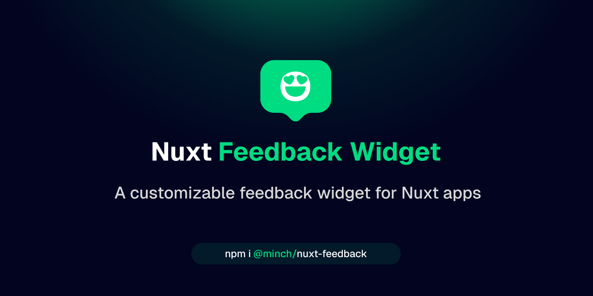

<div align="center">

# Nuxt Feedback Widget

[![npm version][npm-version-src]][npm-version-href]
[![License][license-src]][license-href]
[![Nuxt][nuxt-src]][nuxt-href]

<!--
[![npm downloads][npm-downloads-src]][npm-downloads-href]
[![code quality][code-quality-src]][code-quality-href]
[![bundle size][bundle-size-src]][bundle-size-href]
-->

A simple & customizable feedback widget for your Nuxt apps.

[📖 Documentation](https://nuxt-feedback.minch.dev)

</div>

> [!WARNING]  
> Nuxt Feedback is under active development; expect the API to change between releases.

## Contribution

<details>
  <summary>Local development</summary>
  
  ```bash
  # Install dependencies
  pnpm install
  
  # Develop with the docs/playground
  pnpm run dev
  
  # Build the docs/playground
  pnpm run dev:build
  
  # Run ESLint
  pnpm run lint
  
  # Run Vitest
  pnpm run test
  ```
</details>

## License

[MIT](/LICENSE)

© 2025-present [Dawit Urgessa](https://minch.dev)

<!-- Badges -->

[npm-version-src]: https://img.shields.io/npm/v/@minch/nuxt-feedback/latest.svg?style=flat&colorA=020420&colorB=00DC82
[npm-version-href]: https://npmjs.com/package/@minch/nuxt-feedback
[license-src]: https://img.shields.io/npm/l/@minch/nuxt-feedback.svg?style=flat&colorA=020420&colorB=00DC82
[license-href]: https://npmjs.com/package/@minch/nuxt-feedback
[nuxt-src]: https://img.shields.io/badge/Nuxt-020420?logo=nuxt
[nuxt-href]: https://nuxt.com

<!--
[npm-downloads-href]: https://npm.chart.dev/nuxt-feedback-widget
[npm-downloads-src]: https://img.shields.io/npm/dm/nuxt-feedback-widget.svg?style=flat&colorA=020420&colorB=00DC82
-->
